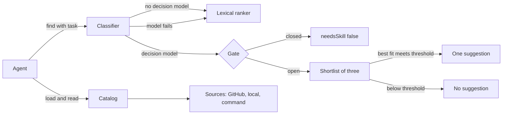

# skills-mcp

skills-mcp is a [Model Context Protocol](https://modelcontextprotocol.io) (MCP) server that keeps a catalog of agent skills out of the model's context. When the agent starts a task, it asks `find` which skill fits, then calls `load` on that one skill.

Any MCP-capable harness can use it. The author runs it with OpenCode V2, and the OpenCode-specific scripts (budget, coverage, cutover) are in this repository too. The server is TypeScript for [Bun](https://bun.sh). It reads skills from GitHub repositories, local directories and command-line tools, and it never runs a skill's files.

**Contents**

- [The problem and the headline numbers](#the-problem-and-the-headline-numbers)
- [How it works](#how-it-works)
- [Evaluation](#evaluation)
- [Tools](#tools)
- [Install and run](#install-and-run)
- [Connect a harness](#connect-a-harness)
- [Configuration](#configuration)
- [Admin CLI](#admin-cli)
- [OpenCode cutover](#opencode-cutover)
- [Development](#development)
- [Security and privacy](#security-and-privacy)
- [Limitations and known issues](#limitations-and-known-issues)
- [License](#license)

Terms follow [GLOSSARY.md](GLOSSARY.md). The work plan is in [docs/plan.md](docs/plan.md).

## The problem and the headline numbers

A harness that loads skills natively places every skill's description in the model's context on every step. That is the [native skill list](GLOSSARY.md). It costs context whether or not the task needs a skill, and in a long list the skill that matters gets forgotten.

skills-mcp moves that list out of the context. The server adds a small fixed cost to each step, and the agent receives one suggested skill on demand.

| Claim | Value | Source | Caveat |
|---|---|---|---|
| Fixed cost of this server | 299 tokens | `bun run budget` | An estimate: characters divided by 4, for the four tools and the server instructions as OpenCode's Code Mode prints them. The renderer is ported from anomalyco/opencode at commit `e23d54ca`. The count covers tool text, not skills, so it does not grow with the catalog. The target is 300; the check fails above 320. |
| Native skill list cost | Not measured in this repository | `docs/plan.md`, decision D1 | The plan estimates about 170 tokens for two builtin skills kept in the native list. A native list grows with every skill it holds. |
| Classifier accuracy | 2 of 40 covered requests (5.0%) end with a suggestion other than the right skill, or none | `docs/eval.md`, shipped thresholds | One labelled set of 60 requests against one catalog of 179 skills. The thresholds were fitted on the same 60 requests. See [Evaluation](#evaluation). |

## How it works



### Catalog and sources

A **source** is a configured place that skills come from. There are three kinds:

- **GitHub source** (`kind: "github"`): a sparse, shallow, blobless clone of a repository, limited to `paths` (default `skills`). Pin it with `ref` (a branch or tag) or `sha` (a full commit id). An unpinned source follows the default branch.
- **Local source** (`kind: "local"`): a directory on your machine. It is scanned in place.
- **Command source** (`kind: "cli"` in the config): a program that prints its skills as JSON. The server runs the configured `list` and `get` commands from an argument array. No shell is involved.

**Sync** brings a source's skills onto disk, in `~/.cache/skills-mcp` unless `SKILLS_MCP_CACHE` says otherwise. Startup and every rebuild read the cache only, so a start never touches the network. Run `sources sync` to refresh. If an online sync fails and a cached copy exists, the cached copy is used and a warning is recorded.

The **catalog** merges all sources into one skill per **skill id**, which is the name of the skill's directory. Sources have an order. When two sources provide the same id, the earlier one keeps it and the later one is reported as **shadowed**. A **skill directory** holds a `SKILL.md` whose frontmatter has a `name` and a `description`. Copies under `upstream/` or `plugins/` (**vendored copies**) fold into the original.

### Trusted and untrusted sources

Every skill, resource and source is data. The server reads skill files and never runs them.

- A **local source** is **trusted**: its top-level symlinks may point outside it.
- A **GitHub source** and a **command source** are **untrusted**: every path is resolved with `realpath` and must stay inside its skill directory.

Who may add or remove sources is covered in [Tools](#tools) and [Security and privacy](#security-and-privacy).

### Finding a skill

`find` takes a **task**, the description of what the agent is about to do. It returns at most one **suggestion** and a list of **candidates**.

Without `decision.model`, `find` ranks candidates with the **lexical ranker** (BM25 over the id, name, description and body excerpt) and never suggests a skill.

With `decision.model`, the **classifier** runs two rounds against a [decision model](GLOSSARY.md):

1. **Call 1, one question per shard.** The catalog is split into shards of at most `shardSize` skills (default 120). Each shard asks the model to choose the skill that fits the task, and the shards run in parallel. Shard 0 also asks the **gate** questions: three yes-or-no questions about whether the task needs a specific procedure (averaged, one of them inverted) and one about whether the task names a specific tool, format, template or method.
2. **Gate.** The gate opens when the average of the procedure questions reaches `thresholds.action`, or the named score reaches `thresholds.named`. A closed gate returns `needsSkill: false`.
3. **Shortlist and rerank (call 2).** The top three candidates are read in full: each one's description and the first 700 characters of its body. The model chooses one, and answers a **fits check** (yes or no) for each of the three.
4. **Suggestion.** The chosen skill is suggested only when its fits probability reaches `thresholds.fits`.

Candidates come from call 1: the top three of each shard, merged and cut to the requested `limit` (default 5, at most 10).

| Situation | `ranker` | `needsSkill` | `suggestion` | `reason` |
|---|---|---|---|---|
| No `decision.model` | `bm25` | `null` | `null` | absent |
| Gate closed | `model` | `false` | `null` | absent |
| Gate open, no skill fits | `model` | `true` | `null` | absent |
| Gate open, a skill fits | `model` | `true` | one skill id | absent |
| Model missing, failed, timed out or answered invalidly | `bm25-fallback` | `null` | `null` | why |

On fallback, `find` still returns lexical candidates, so the agent is never left with nothing. A missing key, an unknown model id, a timeout, rejected credentials, a refusal or a malformed answer all fall back, and `reason` says which.

### Code Mode and the fixed cost

The text the server adds to every model step is kept small:

- Every tool declares an `outputSchema`, so Code Mode shows a typed return, and the schemas are shallow.
- The first line of each tool description is at most 120 characters and is self-sufficient.
- The server instructions are one line: `Call find before non-trivial work; load the suggested skill.`
- Input schemas carry no length limits, because OpenCode would print each one. The handlers enforce the limits instead.

`bun run budget` renders the tools and instructions the way OpenCode prints them, and fails above 320 tokens.

### MCP skills extension

For harnesses without Code Mode, the server also serves the MCP Skills extension (`io.modelcontextprotocol/skills`). It answers:

- `skills/list`: every catalog skill, with its name and description, pointing at its `SKILL.md`;
- `skills/get`: the `SKILL.md` entries;
- `resources/read` on `skill://<id>/<path>`: `SKILL.md` and the listed resources.

Resources are dynamic. When connected, the server sends a resource-list change after each catalog rebuild.

## Evaluation

[docs/eval.md](docs/eval.md) measured the classifier on one labelled set, against the author's catalog of 179 skills from six sources. The set has 60 requests: 40 **covered** requests, each with exactly one correct skill (40 different skills in all), and 20 **uncovered** requests, which are everyday tasks, conceptual questions and near-miss tool requests that no served skill covers.

| Ranker | Wrong, covered (of 40) | Needless, uncovered (of 20) | Right skill in top 3, covered | p50 / p95 ms |
|---|---|---|---|---|
| Decision model, cookbook defaults (0.30 / 0.50 / 0.30) | 4 (10.0%) | 1 (5.0%) | 39 (97.5%) | 392 / 611 |
| Decision model, shipped values (0.25 / 0.50 / 0.35) | 2 (5.0%) | 0 (0.0%) | 39 (97.5%) | 392 / 611 |
| Lexical ranker (no gate) | top-1 wrong: 15 (37.5%) | uncovered with a candidate: 17 (85.0%) | 28 (70.0%) | 3 / 4 |

"Wrong" counts a covered request whose suggestion is not its skill, and no suggestion counts as wrong. "Needless" counts an uncovered request that received a suggestion. The lexical ranker cannot abstain, so its row shows what a top-1 answer would cost without a gate.

Read these numbers with their limits:

- **Small sample.** Sixty requests, forty of them covered. One request moves a covered rate by 2.5 points.
- **Thresholds tuned on the test set.** The shipped values were chosen on the same 60 requests: `action` moved on two requests and `fits` on one. A held-out set is the real test.
- **Requests written with the skill descriptions in view.** Real requests are vaguer, so the real wrong rate will likely be higher.
- **One latency sample** from one live pass, with no rate-limit or overload runs.
- **Hand-checked gold labels.** A contested label counts as wrong even when the suggestion is reasonable.
- **Cost not recorded.** Filling the cache took 180 live calls; no provider usage figures were collected.

To re-run: `bun run eval -- --ranker bm25` needs no key. A model id fills the answer cache with live calls, and `--sweep` re-scores cached answers at every threshold setting with no network. The request set is [eval/requests.jsonl](eval/requests.jsonl).

## Tools

The server exposes four tools. Through OpenCode they appear under `tools.skills.*` inside Code Mode.

| Tool | Read-only | Input | Output |
|---|---|---|---|
| `find` | yes | `task` (1 to 2,000 characters); optional `limit` (integer 1 to 10, default 5) | `needsSkill`, `suggestion`, `ranker`, `reason` (optional), `candidates` as `{id, description, score}` |
| `load` | yes | `id` | `id`, `name`, `description`, `body`, `resources`, `base` |
| `read` | yes | `id`; `path`, relative, at most 512 characters | `text`, or `error`: `binary`, `too-large`, `outside-root` or `missing` |
| `sources` | no | `action` (`list`, `add`, `sync`, `remove`); `id`, `kind` and `repo` as the action needs | `sources` as `"id (kind)"` strings; `warnings` |

- `load` returns the **body** (the instructions after the frontmatter), the **resources** the body can point to, and `base`, the absolute path of the skill directory.
- `read` serves only `SKILL.md` and the listed resources; any other path is `missing`. Files over 256 KiB are `too-large`, and binary files are `binary`.
- Errors come back as MCP error results with a one-line, sanitized message.

### What agents may do with sources

`sources` is the only tool that changes state. It is not marked read-only.

| Agents may | Agents may not |
|---|---|
| `list` the configured sources | add or remove a local or command source |
| `add` a GitHub source by `repo` (the tool stores the default branch and the `skills` path) | set `ref`, `sha` or `paths` through the tool |
| `sync` one source, or all of them online | change what a command source runs. `sync` does run every configured command source, as configured |
| `remove` a GitHub source (its cache is deleted too) | write or run skill files |

To add or remove local and command sources, use the [admin CLI](#admin-cli). The refusal message names it.

## Install and run

**Requirements**

- **Bun.** The project is developed and tested on Bun 1.4.3. It uses Bun APIs (`Bun.spawn`, `Bun.YAML`).
- **git** on your `PATH`, for GitHub sources.
- **A decision-model key**, optional. Without one, `find` still works and ranks lexically. See [Decision models](#decision-models).
- **The `opencode` CLI**, only for `bun run coverage` and `bun run cutover verify`.

**Install**

```sh
git clone https://github.com/heliowap/skills-mcp.git
cd skills-mcp
bun install
bun run verify:all      # typecheck, tests and the fixed-cost budget
```

**Run**

```sh
bun start               # runs src/index.ts
```

The server speaks MCP over stdio. A harness starts it, so you normally do not run it by hand. Run in a terminal, it simply waits for input. stdout carries MCP messages only; diagnostics go to stderr.

## Connect a harness

Replace `<repo>` with the absolute path of your checkout.

**OpenCode V2.** Add the server under `mcp.servers` in your OpenCode config (for example `~/.config/opencode/opencode.jsonc`):

```jsonc
{
  "mcp": {
    "servers": {
      "skills": {
        "type": "local",
        "command": ["bun", "<repo>/src/index.ts"]
      }
    }
  }
}
```

Code Mode then exposes `tools.skills.find`, `tools.skills.load`, `tools.skills.read` and `tools.skills.sources`. The server's instructions tell the agent to call `find` first.

**Any other MCP harness.** Register a stdio server whose command is `bun` and whose argument is the entry point. Key names differ between clients. This is the common shape:

```json
{
  "mcpServers": {
    "skills": {
      "command": "bun",
      "args": ["<repo>/src/index.ts"],
      "env": { "SKILLS_MCP_CONFIG": "/path/to/config.json" }
    }
  }
}
```

The `env` block is optional. Check your harness's documentation for its exact file and key names. Reconnect the harness after changing its config.

## Configuration

### Where it lives

| What | Default | Override |
|---|---|---|
| Config file | `~/.config/skills-mcp/config.json` | `SKILLS_MCP_CONFIG` |
| Cache of synced sources | `~/.cache/skills-mcp` | `SKILLS_MCP_CACHE` |

A missing config file means no sources and the defaults. `sources add` creates the file when it is missing. Tests point both variables at temporary directories.

### Sample

This config has one source of each kind, plus the decision model and its thresholds:

```json
{
  "sources": [
    { "kind": "github", "id": "example-skills", "repo": "owner/skills-repo", "ref": "main", "paths": ["skills"] },
    { "kind": "local", "id": "my-skills", "path": "~/my-skills" },
    {
      "kind": "cli",
      "id": "example-cli",
      "list": ["example-cli", "skills", "list"],
      "get": ["example-cli", "skills", "get"],
      "namesPath": "data.skills",
      "contentPath": "data.content"
    }
  ],
  "decision": {
    "model": "typesafe-ai:jev-1.14.0",
    "thresholds": {
      "typesafe-ai:jev-1.14.0": { "action": 0.25, "named": 0.5, "fits": 0.35 }
    }
  },
  "shardSize": 120,
  "timeoutMs": 3000
}
```

| Field | Default | Meaning |
|---|---|---|
| `sources` | `[]` | Sources in priority order. An earlier source wins a skill-id collision. |
| `decision.model` | none | An id from `src/decision/providers.json`. Unset means lexical ranking only. |
| `decision.thresholds.<model id>` | the providers.json entry, else 0.30 / 0.50 / 0.30 | `action`, `named` and `fits`, each between 0 and 1. |
| `shardSize` | 120 | Skills per decision shard. Values above 255 are clamped to 255. |
| `timeoutMs` | 3000 | Time budget for each decision round (call 1, then call 2), retries included. |

Source fields by kind:

| Kind | Fields | Notes |
|---|---|---|
| `github` | `id`, `repo`; optional `ref`, `sha`, `paths` | `repo` is `owner/repo` or `https://github.com/owner/repo`. `sha` must be a full commit id. `paths` defaults to `["skills"]`. |
| `local` | `id`, `path` | A leading `~/` is expanded, and the path is stored as absolute. Trusted. |
| `cli` | `id`, `list`, `get`, `namesPath`, `contentPath` | `list` prints JSON; the array at `namesPath` names the skills. `get <id>` prints JSON; the Markdown at `contentPath` is the skill. |

Source ids and skill ids use lowercase letters, digits and single hyphens. Source ids are at most 64 characters.

The decision model, thresholds, `shardSize` and `timeoutMs` are read when the server starts. Restart it after changing them.

### Decision models

`decision.model` must name an entry in [`src/decision/providers.json`](src/decision/providers.json), listed below. Without one, `find` uses the trained ranker if its artifacts are present (`"ranker": "trained"`), and otherwise ranks lexically (`"ranker": "bm25"`).

| Model id | Provider | Key variables (first one set wins) | Thresholds in providers.json |
|---|---|---|---|
| `typesafe-ai:jev-1.14.0` | TypeSafe AI | `TYPESAFE_AI_API_KEY`, then `TYPESAFE_API_KEY` | 0.25 / 0.50 / 0.35 |
| `gateway:typesafe-ai/jev` | AI SDK gateway | `AI_GATEWAY_API_KEY` | none, so the config defaults apply |

Threshold precedence, per model: a `decision.thresholds` entry in the config wins. Within that entry, a missing field takes the config default (0.30, 0.50 or 0.30), not the providers.json value. With no config entry, providers.json applies, and then the defaults.

A missing key does not stop the server. `find` falls back to the trained ranker if its artifacts are present (`"ranker": "trained-fallback"`), otherwise to lexical ranking (`"ranker": "bm25-fallback"`), and gives the reason. Thresholds for each model can be set under `decision.thresholds.<model id>` with `action`, `named` and `fits` between 0 and 1.

The `ranker` field is one of `model`, `trained`, `trained-fallback`, `bm25` and `bm25-fallback`.

### Trained fallback (optional)

A trained ranker scores the catalog with weights learned offline from example tasks. Unlike lexical ranking, it can decide that no skill applies. It is opt-in: the server has no trained artifacts until you train them on your own machine, and without them nothing changes.

- **Placement.** The decision model stays primary. The trained ranker answers when no decision model is configured (`"ranker": "trained"`), or when the configured model fails (`"trained-fallback"`, with the reason).
- **Where it lives.** Under the cache: `~/.cache/skills-mcp/trained/` by default, or `trained/` inside `SKILLS_MCP_CACHE`.
- **Privacy.** The directory holds the text of your skills, the example tasks and the teacher's answers. Nothing in it is written into this repository, and it is not committed.
- **How to train.** `teach` asks the teacher, so it needs the key for `typesafe-ai:jev-1.14.0` from the table above. Write the example-task batches between `plan` and `check`, by hand or with an agent:

  ```sh
  bun run train-data plan         # plan the batches
  bun run train-data check --all  # validate the batches
  bun run train-data teach        # ask the teacher and keep the rows it agrees with
  bun run train-data topup        # more batches for skills with few kept examples
  bun run train                   # fit and write the artifacts; no network
  ```

  Restart the server afterwards: the artifacts are read at startup and on rebuild.
- **Staleness.** A change to any `SKILL.md` in the catalog makes the trained ranker stale. The server then stops using it, reports a warning and ranks lexically, until `teach` and `train` run again.
- **Results.** The measured numbers and the target comparison are in [docs/eval.md](docs/eval.md#trained-ranker).

Keys are read from the environment by name when the server starts. They never go in the config file.

With no usable key the server still starts. `find` falls back as described above (`trained-fallback` or `bm25-fallback`), and `reason` names the variable to set:

```text
no API key for "typesafe-ai:jev-1.14.0": set TYPESAFE_AI_API_KEY or TYPESAFE_API_KEY
```

An id missing from providers.json gives `unknown decision model "<id>"; add it to providers.json`.

To add a model, add an entry to `providers.json` with `provider` (`typesafe-ai` or `gateway`), `modelId`, `keyEnv` (variable names in priority order), and optionally `thresholds` and `baseURL`.

## Admin CLI

Run these from the checkout with Bun. The CLI reads and writes the same config file and cache as the server. It prints JSON on stdout and failures on stderr.

```sh
bun src/cli.ts find --json "fill in a PDF form"
bun src/cli.ts sources list
bun src/cli.ts sources add '<json source spec>'
bun src/cli.ts sources sync [id]
bun src/cli.ts sources remove <id>
```

**`find --json "<task>"`** prints the result shape of the `find` tool. The `--json` flag is required, and the task is the rest of the command line. With no `decision.model`, no model is called:

```json
{
  "needsSkill": null,
  "suggestion": null,
  "ranker": "bm25",
  "candidates": [
    { "id": "pdf-forms", "description": "Fill in PDF forms and extract their fields.", "score": 3.03 }
  ]
}
```

**`sources list`** prints the configured sources as stored, in priority order.

**`sources add '<json>'`** validates a full source spec (all three kinds) and appends it. It stores the spec and does not sync, so follow it with `sources sync <id>`:

```sh
bun src/cli.ts sources add '{"kind":"local","id":"my-skills","path":"~/my-skills"}'
bun src/cli.ts sources sync my-skills
```

**`sources sync [id]`** syncs one source, or every source when no id is given. It prints one outcome per source, and exits 1 if any sync failed.

**`sources remove <id>`** removes the source from the config, and deletes the cache of a GitHub or command source. It prints `{ "removed": "<id>" }`.

**Exit codes.** `0`: done. `1`: failure, with the reason on stderr; for example an invalid spec, an unknown source id, or a failed sync. `2`: usage; for example no command, an unknown command, or `find` without `--json`.

A running server does not see CLI changes until it rebuilds its catalog, which happens at startup or after one of its own `sources` calls. Reconnect the harness after a CLI change.

## OpenCode cutover

The cutover moves an OpenCode V2 setup from its native skill list and its CLI-backed MCP servers to this server. It is reversible.

```sh
bun run cutover plan      # print the diff that apply would make; writes nothing
bun run cutover apply     # back up the config, then make the edits
bun run cutover verify    # read OpenCode's state and check it; writes nothing
bun run cutover revert    # restore the newest backup, byte for byte
```

Options: `--config <file>` (or `SKILLS_MCP_OPENCODE_CONFIG`; default `~/.config/opencode/opencode.jsonc`) and `--repo <dir>` (or `SKILLS_MCP_REPO`; default this checkout). `verify` also takes `--dir` and `--opencode`.

`apply` changes only these paths, and checks that before it writes:

- adds `mcp.servers.skills`, a local server that runs `bun <repo>/src/index.ts`;
- disables the two CLI-backed MCP servers that the skills server replaces;
- removes the legacy V1-shaped entry that sits directly under `mcp`. OpenCode still loads that entry as a live server, so removing it turns off the MCP server it defines. [docs/cutover.md](docs/cutover.md) lists this as a known risk;
- appends the cutover plugin, `opencode-plugin/skills-cutover`, to `plugins`.

The plugin keeps OpenCode's builtin skills in the native list, sets `autoinvoke: false` on every other skill, and disables an MCP server that a third-party plugin registers. `autoinvoke: false` only hides a skill from the native list. [docs/cutover.md](docs/cutover.md) records an isolated check that hidden skills stay loadable by id, and this server's `load` serves every catalog skill anyway.

Safety properties:

- `apply` refuses rather than guesses: a comment inside a removed entry, an existing `mcp.servers.skills` with other settings, or an edit outside the listed paths. Each refusal names the path.
- Comments and layout survive. Edits are spliced into the original text.
- Each apply writes a new backup named `<config>.bak-<timestamp>-before-skills-mcp`, and never overwrites one.
- `revert` keeps the bytes it replaces in a `...-before-revert` file, so edits made after `apply` are not lost.
- `verify` expects the three builtin skills to be advertised, `mcp skills` to be connected, and the disabled servers to be absent or disabled. It reads up to three times, three seconds apart, because a freshly reloaded server can answer with an empty list for a moment.

Run `plan` and read the diff before `apply`, since `apply` edits your global OpenCode config. Then `apply`, wait for OpenCode to reload, run `verify`, and `revert` if needed. The config paths the cutover writes are absolute. If you move the checkout, run `revert`, then `apply` again.

## Development

| Command | Purpose |
|---|---|
| `bun start` | Run the stdio server |
| `bun test` | Every test, offline. `bun test test/mcp` covers the server, the CLI, the skills extension and the budget |
| `bun run typecheck` | `tsc --noEmit` |
| `bun run budget` | Fixed-cost estimate; fails above 320 tokens. `-- --show` prints the rendered text |
| `bun run coverage` | Compares OpenCode's registered skills with the catalog. Exits 1 if one is missing or unreadable. Needs the `opencode` CLI |
| `bun run eval -- --ranker <model id or bm25>` | Scores the classifier on `eval/requests.jsonl`. `--sweep` re-scores cached answers with no network |
| `bun run cutover <plan\|apply\|verify\|revert>` | The OpenCode cutover |
| `bun run verify:all` | Typecheck, tests and budget |

Project layout:

```text
src/
  index.ts        stdio entry point
  cli.ts          admin CLI
  app.ts          composition root: config, sources, catalog, classifier
  config.ts       config schema, load and save
  paths.ts        config and cache locations
  catalog.ts      merge, dedupe, safe file reads
  types.ts        shared contracts
  skill/          frontmatter, validation, directory scan
  sources/        GitHub, local and command sources; registry; process and git helpers
  decision/       decision-model adapter (the only file that imports the AI SDK), providers.json, retry
  rank/           lexical ranker, classifier, sharding
  mcp/            server, tools, skills extension, in-process JSON-RPC driver
scripts/          budget, coverage, eval, cutover
opencode-plugin/  skills-cutover, the OpenCode plugin the cutover registers
test/             offline tests and fixtures
eval/             labelled requests; the answer cache is git-ignored
docs/             plan, evaluation results, cutover runbook, coding standards
```

Read these before changing code:

- [AGENTS.md](AGENTS.md): English for every file, and the glossary terms.
- [docs/coding-standards.md](docs/coding-standards.md): module boundaries, the rules for untrusted content, the MCP surface, and TypeScript style.
- [GLOSSARY.md](GLOSSARY.md): the domain terms.

**Tests stay offline.** They use stub decision models, local bare git repositories and fake CLI scripts. The config and cache point at temporary directories through `SKILLS_MCP_CONFIG` and `SKILLS_MCP_CACHE`, so tests never read your configuration. Live tests run only when their credentials are set: `test/decision/live.test.ts` needs a TypeSafe key, and the command-source live test needs `SKILLS_MCP_LIVE_CLI`.

## Security and privacy

**Untrusted content**

- Every skill, resource and source is data. The server reads and returns text. It never executes a file from a skill.
- Every path is resolved with `realpath` and must stay inside its skill directory. `read` checks containment before it serves a file. The one exception is a local source's top-level symlinks, which are trusted.
- Names and descriptions shown to the agent are validated and sanitized: control characters and XML-like tags are removed, and length is capped.
- `load`'s `body` and `read`'s `text` are returned verbatim. They are untrusted skill content, and the harness should treat them as third-party text.
- Size limits: 512 files and 16 MiB per skill; 256 KiB per served resource; a scan stops at depth 6 or 20,000 entries.

**Who may add sources**

- Local and command sources come only from the config file or the admin CLI.
- Agents may add and remove GitHub sources through the `sources` tool.
- A command source runs a program, so only you add one.

**Processes and environment**

- Commands start from an argument array, with a timeout and an output cap. No shell is involved.
- Command sources get an allowlisted environment: `PATH`, `HOME`, `LANG`, `LC_ALL`, `TMPDIR`, `USER` and `SHELL`. API keys are not passed to them.
- Git runs with `GIT_TERMINAL_PROMPT=0` and without the repository override variables. Git otherwise inherits the server's environment, so API keys are visible to git. Git does not use them.

**Keys and logs**

- Keys are read by name from the environment at startup. They do not appear in the config file, logs, errors or tool output. Errors name the variable, never its value.
- Diagnostics go to stderr. Tool errors reach the agent as one sanitized line, and the same sanitized line is written to stderr.

**What leaves your machine**

- `find` with no decision model sends nothing.
- `find` with a decision model sends the task text, the skill ids and descriptions (each cut to a character budget), and, for the three shortlisted skills, the first 700 characters of their bodies. `typesafe-ai` entries send this to the TypeSafe AI API (`https://api.typesafe.ai/v1`); `gateway` entries send it through the AI SDK gateway. Resources, full bodies, paths, the config file and keys are not sent.
- `sources sync` on a GitHub source contacts GitHub. A command source runs its configured program, which can do whatever that program does.
- `load` returns `base`, the absolute path of the skill directory on your machine, into the agent's context. Keep that in mind before you share a transcript.

## Limitations and known issues

- **No model, no suggestion.** Without `decision.model`, `find` returns candidates and a null suggestion. The lexical ranker cannot abstain.
- **Latency and cost with a model.** A `find` makes up to two rounds of model calls, each bounded by `timeoutMs`. The eval measured p50 392 ms and p95 611 ms on one pass. Provider cost is per call and was not measured.
- **Thresholds are provisional.** They were fitted on 60 requests from one catalog, so expect different rates on yours. Run the eval on your own labelled requests before you rely on them.
- **Restart for configuration changes.** The decision model, thresholds, `shardSize` and `timeoutMs` are read at startup. Changes made with the CLI reach a running server at its next rebuild. Reconnect the harness after editing the config.
- **Local source edits need a rebuild.** A local source is scanned in place, but only when the catalog is rebuilt. A new or edited skill appears after `sources sync` or a restart.
- **`disable-model-invocation` is ignored.** A skill whose frontmatter sets `disable-model-invocation` is still served by `find` and `load`. The server reads only `name` and `description` from frontmatter. This was checked in the code and by a run against a temporary source.
- **Agent-added GitHub sources are limited.** The tool stores the default branch and the `skills` path. Pins and other paths need the config file or the CLI.
- **No cross-process lock.** The server serializes its own source changes, but the CLI and a running server each write the config file without a lock. Do not run both at the same moment.
- **Git sees your environment.** See [Security and privacy](#security-and-privacy).
- **Stdio only.** The server has no HTTP transport.
- **The fixed-cost figure is an estimate.** It depends on OpenCode's renderer as ported at `e23d54ca`. Re-run `bun run budget` after OpenCode changes how it renders tools.

## License

skills-mcp is released under the [MIT License](LICENSE). Copyright (c) 2026 Helio Pinheiro.
